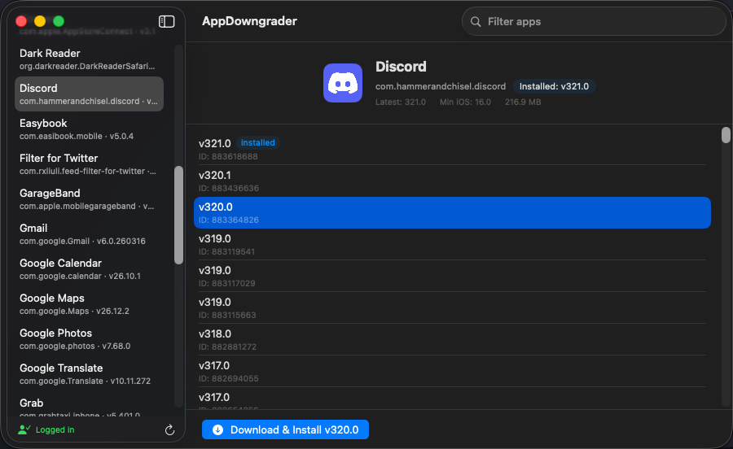

# AppDowngrader

A macOS app for downgrading iOS apps to older versions. It provides a GUI for browsing installed apps on your iOS device, viewing available historical versions, and installing any previous version.

[](https://www.youtube.com/watch?v=ZYa1Teq-5kI)

## Features

- Browse installed apps on connected iOS devices
- View all available historical versions for each app
- Download and install any previous version with one click
- Apple ID authentication with 2FA support
- Bundled tools (ipatool + go-ios) — no manual dependency installation

## Requirements

- macOS 14.0+
- An iOS device connected via USB
- An Apple ID (for downloading apps from the App Store)

## Install

**Homebrew (recommended):**

```bash
brew install rxliuli/tap/app-downgrader
```

**Manual:** Download the latest `.dmg` from [Releases](https://github.com/rxliuli/AppDowngrader/releases), open it, and drag AppDowngrader to Applications.

## First Run: macOS Keychain Prompt

On first use, macOS may show a system dialog asking to allow **ipatool** to access your Keychain:

> "ipatool wants to use your confidential information stored in your keychain. To allow this, enter the \"login\" keychain password."

This is normal and safe:

- The password it asks for is your **Mac login (user account) password** — *not* your Apple ID password.
- It is macOS asking permission for ipatool to securely read the Apple ID credentials stored in your Keychain, so you don't have to type them every time.
- Select **Always Allow** so you only see it once. If you pick **Allow**, macOS may ask again on the next operation — simply pick **Always Allow**.

## Build from Source

```bash
# Bundle the third-party tools (ipatool, go-ios). They are not committed: this downloads
# them from the pinned urls in scripts/binaries.json and verifies each sha256. Re-running
# is a cache hit, and a version bump is a manifest edit.
bash scripts/fetch-bin.sh

# Run in development
swift run
```

Release builds (Developer ID archive → notarized DMG → Homebrew cask) run in CI:
`.github/workflows/release.yml` archives with xcodegen + `rxliuli/apple-release/dmg`, which
needs the signing secrets from the `release-macOS` environment.

Or open `AppDowngrader.xcodeproj` in Xcode for Archive and notarization.

Without `scripts/fetch-bin.sh` the app refuses to run either tool (it used to fall back to
whatever was on `PATH`, which silently picked a stale Homebrew build), so a source build
without that step lands on the "Missing Bundled Tools" screen.

## Limitations

- Some apps may fail to list versions due to Apple API restrictions
- Paid apps require a prior purchase on the same Apple ID
- Apple may change or restrict the APIs this tool depends on

## Support

If you find this tool useful, consider [sponsoring me on GitHub](https://github.com/sponsors/rxliuli).

## License

MIT
